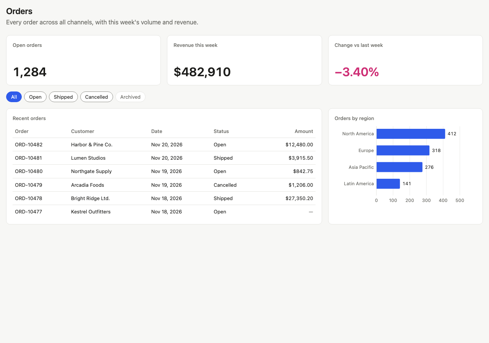

# Gate 2: DESIGN.md

**Status:** awaiting review.

## What was produced

| Artifact                                                                                                                                                      | Where                                                                        |
| ------------------------------------------------------------------------------------------------------------------------------------------------------------- | ---------------------------------------------------------------------------- |
| `DESIGN.md`: generated front matter + curated prose, 8 standard sections in order + 4 custom (Data Visualization, Motion, Content & Formatting, Host Theming) | [`DESIGN.md`](../../DESIGN.md)                                               |
| Front-matter generator (tokens → DESIGN.md names, component references resolved from token reference chains)                                                  | [`scripts/design-md/frontmatter.ts`](../../scripts/design-md/frontmatter.ts) |
| Adapter: the only code that calls `@google/design.md` (pinned **0.4.0**, format `alpha`)                                                                      | [`scripts/design-md/adapter.ts`](../../scripts/design-md/adapter.ts)         |
| Commands: `design:build`, `design:check`, `design:lint`, `design:diff`, `design:taste`                                                                        | [`scripts/design-md/cli.ts`](../../scripts/design-md/cli.ts)                 |
| learn-taste: Do's and Don'ts change only on a `taste/*` branch, via PR                                                                                        | `design:taste` + a guard in `.claude/hooks/guard-paths.mjs`                  |
| Sample prompt and the screen an agent built from DESIGN.md alone                                                                                              | [`sample-prompt.md`](sample-prompt.md), [`sample-output/`](sample-output/)   |

`verify` now also runs `design:check`, `design:lint` and `design:diff`.

## Check results

| Check                  | Result                                                                                                                                                                                                |
| ---------------------- | ----------------------------------------------------------------------------------------------------------------------------------------------------------------------------------------------------- |
| `npm run design:lint`  | **clean**: 0 errors, 0 warnings, 1 info (token summary); 12 sections in order                                                                                                                         |
| `npm run design:check` | front matter current (Prettier-stable); `export --format dtcg` round-trips to the tokens it came from                                                                                                 |
| `npm run design:diff`  | no `DESIGN.md` on `master` yet, so nothing to compare; it runs against `master` from the first merge                                                                                                  |
| `npm run verify`       | pass (59 unit tests, including 7 for DESIGN.md)                                                                                                                                                       |
| learn-taste            | tested end to end in a throwaway worktree: branch `taste/…` created, rule appended with provenance, lint clean; the guard blocks direct edits to the section (exit 2) and allows the rest of the file |

## Decisions made in this phase

1. **Light values in the front matter, other themes in prose.** The format has no modes. The front
   matter carries light / comfortable; dark, high contrast and compact are documented by name and
   live in `tokens/` and the generated CSS.
2. **Only colours a component uses are in the front matter.** The linter's `orphaned-tokens` rule
   flags anything else. Data palettes are declared as the chart components that consume them
   (`chart-series-N`, `chart-sequential-blue-N`, …). Strokes are thin components (`panel-outline`,
   `focus-ring`), because the format has no border property. `surface-raised` and
   `status.{warning,success,info}` stay in `tokens/` until a component uses them.
3. **Legend policy, unified:** above the plot, left-aligned, horizontal, in Vega-Lite, Flint and
   Plotly. The exception is a continuous colour key (heatmaps), which sits beside the plot: Flint
   1.0.1 sizes heatmap cells to the full height, and a top key pushed the chart out of its panel
   (found by rendering and fixed with a Flint theme variant; [image](heatmap-legend-beside.png)).
4. **Chip states are tokens.** `hover`, `pressed`, `selected-hover` and `disabled` were added, plus a
   new semantic `color.bg.pressed`. The validator caught the first attempt: black on dark grey,
   3.92:1 in high contrast. All states now pass in every theme (141 contrast pairs).
5. **New format token** `currency-2` (`$,.2f`) for amounts in tables.

## Sample: an agent builds a screen from DESIGN.md alone

A fresh subagent got [`sample-prompt.md`](sample-prompt.md) and only `DESIGN.md`, and built an
"Orders" admin page: title band, three KPIs (one a negative delta), chips in every state, a table
and a bar chart.

- **Mechanical check:** 11 distinct colours used, **0 not in the front matter**; 61 custom
  properties declared once in `:root`. The only raw values outside `:root` are `132px` (KPI row
  height, which was only in the prose) and `760px` (a media query, where CSS variables can't be used).
- **By eye:** it reads as the same system as the dashboards (canvas, panels, pill chips, sorted
  bars with direct labels, an em dash for the missing amount, a signed delta in the negative colour).

The agent reported 12 gaps. What happened to each:

| Gap                                                          | Disposition                                                                    |
| ------------------------------------------------------------ | ------------------------------------------------------------------------------ |
| No table component (header, cell padding, row lines)         | **Phase 3 gap:** needs a catalog item and LLD, not prose                       |
| No status badge for order status                             | **Phase 3 gap**                                                                |
| A KPI that is itself a delta                                 | **Fixed** in Components                                                        |
| Chip pressed/selected/disabled borders, y padding            | **Fixed** in Components (tokens added this phase)                              |
| Focus offset and KPI row height only in prose                | **Fixed**: row height is per spec (documented); focus offset in Components     |
| Strokes as `height`/`width`                                  | **Documented** in Components (format limitation)                               |
| One series vs categorical colour                             | **Fixed** in Data Visualization                                                |
| Unnamed page-level spacing                                   | **Fixed** in Layout                                                            |
| Font fallback stack not spelled out                          | **Fixed** in Typography                                                        |
| Dark/hc/compact values not in DESIGN.md                      | **By design** (no modes in the format); documented in Colors and Host Theming  |
| Breakpoint can't be a CSS variable                           | **Documented** in Content & Formatting                                         |
| Repo-specific wording in a Don't (`src/theme/`, `npm run …`) | **Open**: Do's and Don'ts only change through `design:taste` + PR (question 2) |

## Not done / deferred

- Linux screenshot baselines are still pending from Gate 1 (Docker). This phase also moved legends to
  the top in Vega-Lite and Flint, so `revenue-overview` changes again. Review the new baselines with
  the legend change in mind.
- The `design.md` README says `-` reads stdin, but 0.4.0 rejects it; the adapter uses temp files.
  `export --format dtcg` drops `lineHeight`, so line heights are checked in the front matter only.
  Both are isolated in the adapter and the check.
- The Do's and Don'ts content itself wasn't changed after the guard went in.

## Open questions

1. Do you agree with the legend exception (colour keys beside the plot), or should heatmaps get a
   fixed key height so the key can sit on top too? The second option means more Flint workarounds.
2. Should the repo-specific Don't ("Don't hard-code … `src/theme/` … `npm run lint:no-raw-values`")
   become tool-neutral for agents working outside this repo? If yes, I'll make the change through
   `npm run design:taste` and a PR, as the new rule requires.
