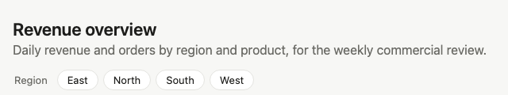
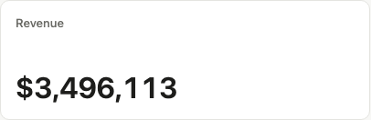
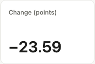

# Interface inventory (Phase 0)

Frost-style inventory (_Atomic Design_, ch. 4) of everything the factory renders today: 2 dashboards
(`revenue-overview`, `sp500-today`), 14 panels, the index page and the filter bar. Values come from
[`code-inventory.csv`](code-inventory.csv) and [`design-inventory.csv`](design-inventory.csv). Crops
are the current per-panel Playwright baselines, copied into [`img/`](img/).

Counts are **variants / instances**. A variant is a visibly different treatment of the same job.

## Summary

| Category           | Variants        | Instances                                                               | Duplicates / problems                                                                                                                  |
| ------------------ | --------------- | ----------------------------------------------------------------------- | -------------------------------------------------------------------------------------------------------------------------------------- |
| Page title band    | 1               | 2 pages + index                                                         | none (`.dashboard-header`)                                                                                                             |
| Navigation         | 1               | index cards                                                             | index cards reuse `.panel` (the dashboard panel class)                                                                                 |
| Buttons            | 2               | chip, clear chip                                                        | no button atom; both are `.chip`; on-state text is raw `#fff`                                                                          |
| Inputs             | 2               | native `<select>`, chip group                                           | `select` styled as a pill; border is 1.27:1 against the surface (fails 3:1 for a control boundary)                                     |
| Cards / containers | 1               | 14 panels + index cards                                                 | one `.panel` style for two jobs                                                                                                        |
| KPI tiles          | 1               | 9                                                                       | value only: no delta, sign colour, target, unit or sparkline; `−23.59` looks the same as `7,720.39`                                    |
| Chart types        | 5               | line, ranked bars, scatter, heatmap, candlestick                        | one per renderer, so each renderer has its own chrome                                                                                  |
| Legends            | **4**           | VL, Plotly, Flint, D3 (direct labels)                                   | hollow circles at the bottom vs filled dots at the top vs a gradient with a black bold title vs none ([crop](img/legend-variants.png)) |
| Axes               | **3**           | VL, Plotly, Flint                                                       | x-grid off (VL) vs on (Plotly) vs preset (Flint); axis titles explicit (VL), raw lowercase field names (Plotly), omitted (Flint)       |
| Number formats     | **3 paths**     | d3-format (KPI, VL, D3), Flint semantics, Plotly default                | revenue alone is formatted 4 ways: `$,.0f`, `$~s`, `$.3~s`, Flint `Amount/USD`; the Plotly y-axis shows `6000`, not `6,000`            |
| Tooltips           | 3               | Vega tooltip, Plotly hover, native SVG `<title>` (D3)                   | plus `title=` on panel headings for descriptions, which keyboard and screen-reader users can't reach                                   |
| Tables             | 0               | —                                                                       | no table, matrix or data-table fallback for charts                                                                                     |
| Empty states       | 3               | `No data` (D3 only), KPI `—`, nothing (VL/Flint/Plotly draw empty axes) | no shared EmptyState                                                                                                                   |
| Loading states     | 1               | `Loading data…` text                                                    | no skeleton; panels pop in                                                                                                             |
| Error states       | 1 style, 4 uses | panel boundary, dataset error, invalid spec, unknown id                 | raw `#b42318`, a fourth red in the system                                                                                              |
| Icons              | 0               | favicon only                                                            | no icon set                                                                                                                            |
| Motion             | 0               | —                                                                       | no durations, easings or transitions anywhere: a clean start                                                                           |
| Themes             | 1               | light                                                                   | CSS variables are set inline on `:root` from JS (`theme/css.ts`); no `[data-theme]`, no dark or high-contrast theme                    |

## Category detail

### Title band, navigation, containers

- `.dashboard-header`: `h1` 22px/600 and `p` in muted text. Same markup on the index page.
- `.panel`: 1px `--border`, `--radius` 10px, `--pad` 16px, white surface. Its heading is 13px/500 muted.
  The index page reuses `.panel` for `<li>` cards, so a panel restyle would also restyle navigation.
- Layout: `.row` is a **12-column** CSS grid with `gap: 16px` and a fixed row height in px from the spec.
  It collapses to one column below **760px** (a raw breakpoint).

### Controls (filter bar)

- Multiselect → a `fieldset` of `.chip` toggles (`aria-pressed`), plus a `.chip-clear`.
- Select → a native `<select>` with the same pill styling.
- Pill radius `999px` and padding `4px 12px` are raw values; selected state is `--accent` with raw `#fff` text (5.52:1, passes).
- **Accessibility gap:** chip and select borders are `--border` `#e4e4e0` on white (1.27:1). WCAG 1.4.11
  requires 3:1 for the visual boundary of a control that has no other affordance.

### KPI tiles (9 instances: the most reused visual)

 

- 32px/600, tabular numerals, `-0.01em` tracking, aligned to the bottom. The label is the panel `h2`.
- Only `value` is modelled. On `sp500-today`, 3 of 6 KPIs are comparisons (change, change %, previous
  close) shown as unrelated tiles: the period-comparison pattern has no component.
- Single-row datasets use `aggregate: max` (5×) or `min` as a stand-in for "the value". See the reuse scan.

### Charts and chart chrome

| Panel                       | Renderer          | Crop                                                   | Notes                                                                                                                                                             |
| --------------------------- | ----------------- | ------------------------------------------------------ | ----------------------------------------------------------------------------------------------------------------------------------------------------------------- |
| Weekly revenue by region    | vega-lite         | [trend](img/revenue-overview--trend.png)               | bottom legend, hollow symbols, y-axis title "Revenue"                                                                                                             |
| Revenue by product          | d3 `RankedBars`   | [bars](img/revenue-overview--by-product.png)           | raw `LABEL_W 96`, `VALUE_W 64`, `rx 2`, offsets 6/8; value labels `$1.5M`                                                                                         |
| Orders vs revenue           | plotly            | [scatter](img/revenue-overview--orders-vs-revenue.png) | top legend, raw margins `56/12/44`, marker `5px @ 0.7`, unformatted ticks, lowercase axis titles                                                                  |
| Revenue by region × product | flint Heatmap     | [heatmap](img/revenue-overview--heatmap.png)           | legend title in `#181818` bold (preset leak); Flint re-quantizes our 6-stop ramp, so the blues differ from a VL heatmap                                           |
| Intraday candles            | flint Candlestick | [candles](img/sp500-today--intraday.png)               | up/down `#06982d` / `#ae1325` are Flint built-ins; tick labels smaller than the VL ones; about 80px of empty panel below the plot (sizing bug, not a style issue) |

What the Flint theme leaves to the preset: our theme overrides 15 of 76 `datawrapper` leaf values.
The other 61 (diverging palette, baseline colour `#181818`, value-label colour, point size 48,
legend direction, axis-title policy, …) are decided by a third party. See `design-inventory.csv`,
`status = inherited-uncontrolled`.

### Colour

- Text: token `#1d1d1b`, but `#181818` and `#000000` reach the screen from Flint.
- Reds: `#b42318` (error CSS), `#c94747` (categorical 7), `#ae1325` (candle down), `#c71e1d`
  (preset diverging end). That's four reds and no semantic `negative` / `danger` token.
- Greens: `#1f9d74` (categorical 3), `#06982d` (candle up). No `positive` token.
- Palette health: see [`palette-audit.md`](palette-audit.md). Categorical 1/8 (blue/violet) drop to
  ΔE₀₀ 5.0–5.5 under protanopia and deuteranopia, plus 5/7 (deuteranopia) and 2/5 (protanopia).
  Sequential stop 1 is 1.12:1 on white.

### Typography

| Size | Where                                                       | Token?                                        |
| ---- | ----------------------------------------------------------- | --------------------------------------------- |
| 11   | chart labels (VL, Flint, Plotly, D3)                        | `font.sizeLabel`                              |
| 12   | index `code`                                                | raw                                           |
| 13   | panel title, filters, chips, status, error, index text (6×) | `font.sizeTitle` exists but CSS never uses it |
| 15   | index card title                                            | raw                                           |
| 22   | page title                                                  | raw (also Flint headline 22, unused)          |
| 32   | KPI value                                                   | raw                                           |

Weights 500 and 600 are raw in CSS and in the VL config. One family (Inter stack); Flint's preset
headline family is Roboto, but no rendered element uses it.

### Spacing, radius, size

- Spacing in CSS: 4, 6, 8, 12, 16, 24, 48 px. Only 16 (`gap`, `pad`) is a token.
- Radius: 2 (bar ends: VL `cornerRadiusEnd` **and** D3 `rx`, defined twice), 10 (panel), 999 (pill),
  7 (favicon).
- Container: `max-width: 1440px`; breakpoint 760px. Neither is a token.

## Duplicates to remove (feeds Gate 3's deprecation list)

1. `.panel` used as both the dashboard panel and the index card.
2. `13px` hard-coded 6× while `font.sizeTitle: 13` exists.
3. Bar corner radius 2 defined in `vegaTheme.ts` and again in `RankedBars.tsx`.
4. Four legend treatments, three axis treatments, three tooltip mechanisms.
5. Four reds and two greens with no semantic role.
6. Two renderings of the "same" sequential ramp (VL range vs Flint Lab quantize).
7. Three empty-state behaviours.
