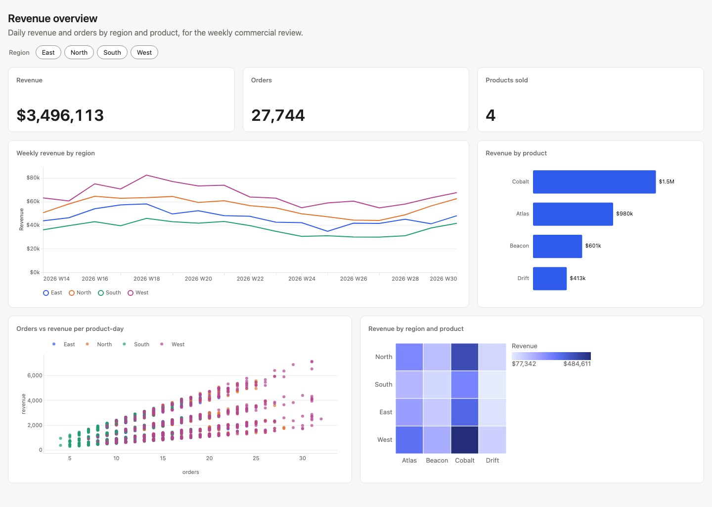
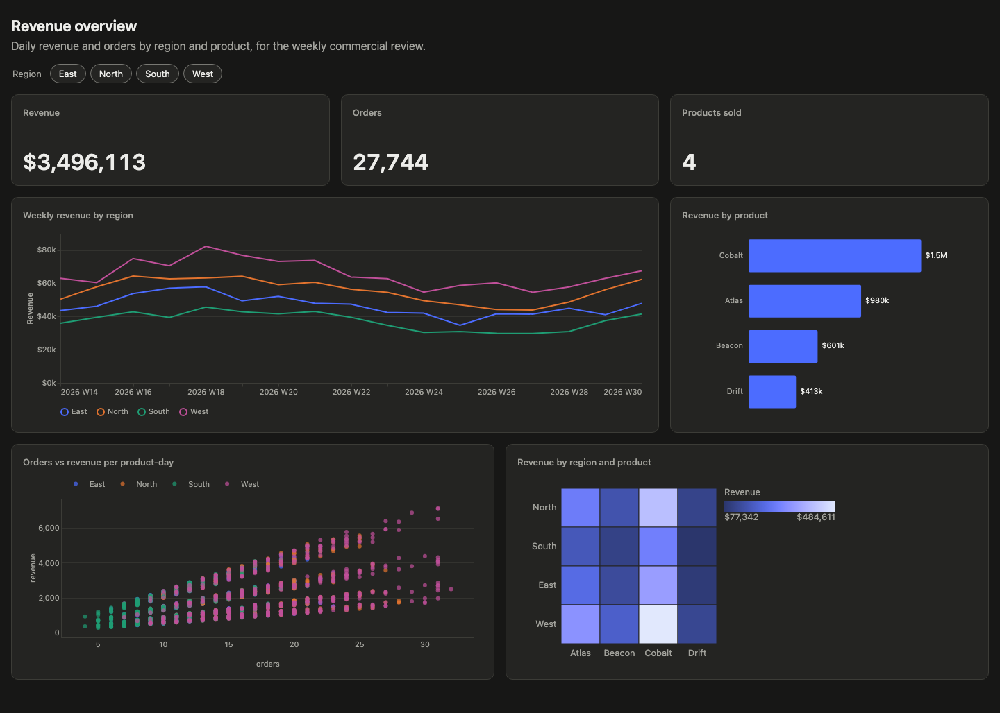
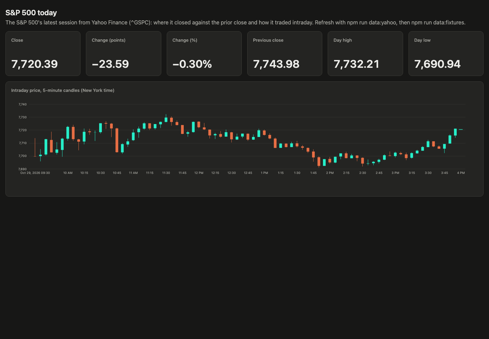
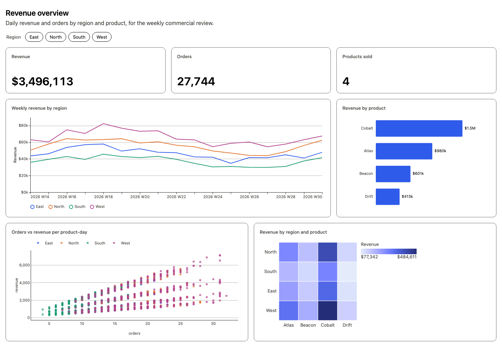

# Gate 1: token architecture

**Status:** awaiting review. Linux screenshot baselines are still pending (Docker wasn't running; see
"Not done").

## What was produced

| Artifact                                                    | Where                                                                                                         |
| ----------------------------------------------------------- | ------------------------------------------------------------------------------------------------------------- |
| DTCG 2025.10 token source, 3 tiers × 3 themes × 2 densities | [`tokens/`](../../tokens) (19 files) + `tokens/format.json`                                                   |
| Resolver, validators, build, engine adapters                | [`scripts/tokens/`](../../scripts/tokens): `lib.ts`, `validate.ts`, `build.ts`, `engines.ts`, `color-math.ts` |
| Generated outputs (write-protected, drift-checked)          | `src/theme/generated/{tokens.css, themes.ts, engines.ts, figma-variables.json}`, `public/favicon.svg`         |
| Contrast matrix (generated)                                 | [`contrast-matrix.md`](contrast-matrix.md)                                                                    |
| Swatches (stand-in for Storybook Foundations, Phase 5)      | `#/foundations` in the app, rendered from the generated tokens ([screenshot](img/foundations.png))            |
| ADR-001                                                     | [`docs/adr/ADR-001-token-source-of-truth.md`](../adr/ADR-001-token-source-of-truth.md)                        |
| Runtime theming                                             | `ThemeProvider` (`?theme=light\|dark\|hc`, `?density=compact`, else system preference)                        |
| New checks in `npm run verify`                              | `lint:no-raw-values`, `tokens:validate`, `tokens:build --check`                                               |

## Check results

| Check                                   | Result                                                                                                                                                                            |
| --------------------------------------- | --------------------------------------------------------------------------------------------------------------------------------------------------------------------------------- |
| `npm run verify`                        | pass (typecheck, lint, no-raw-values, tokens, specs, 52 unit tests)                                                                                                               |
| `tokens:validate`                       | 129 contrast pairs, 0 errors, 0 warnings                                                                                                                                          |
| `tokens:build --check`                  | generated files up to date                                                                                                                                                        |
| `lint:no-raw-values`                    | 0 raw values outside `src/theme/`; 4 justified `raw-ok` exceptions (2 Flint literals being remapped, the media-query breakpoint checked against its token, one grid column count) |
| Browser: every dashboard in dark and hc | 4/4 pass, every panel drawn, no console errors                                                                                                                                    |
| Browser: light screenshot baselines     | **not updated**: needs the Docker (Linux) run below                                                                                                                               |

## Token diff (before → after)

277 tokens per theme × density combination:

| Tier      | Count |
| --------- | ----- |
| primitive | 68    |
| dataviz   | 56    |
| motion    | 9     |
| semantic  | 68    |
| component | 63    |
| density   | 13    |

That's up from 15 values in one `tokens.ts`. The old tokens map as follows:

| Before (`tokens.ts`)       | After                                                                                  | Value                                                                                       |
| -------------------------- | -------------------------------------------------------------------------------------- | ------------------------------------------------------------------------------------------- |
| `color.background`         | `color.bg.canvas` → `color.neutral.25`                                                 | `#f7f7f5` (same)                                                                            |
| `color.surface`            | `color.bg.surface` → `color.neutral.0`                                                 | `#ffffff` (same)                                                                            |
| `color.border`             | `color.border.subtle` (panels); **new** `color.border.control` for chips and selects   | `#e4e4e0` (same); control `#8b8b85` (**was 1.27:1, now 3.43:1**)                            |
| `color.text` / `textMuted` | `color.text.primary` / `muted`                                                         | same                                                                                        |
| `color.grid`               | `color.data.gridline`                                                                  | same                                                                                        |
| `color.accent`             | `color.bg.accent` → `color.brand.500`                                                  | same                                                                                        |
| `categorical` (8)          | `color.data.categorical.1–10`                                                          | 1–4 kept, 5–10 replaced: worst colour-blind ΔE₀₀ **5.0 → 8.9** (all 10), **12.1** (first 8) |
| `sequential` (6)           | `color.data.sequential.blue.1–9`                                                       | even lightness steps (8.7 L* each); stop 1 ΔE₀₀ 8.3 from white (was 1.12:1)                 |
| —                          | `color.data.diverging.blue-orange.-4…+4`                                               | **new**; replaces the borrowed Datawrapper diverging palette                                |
| —                          | `color.data.positive / negative / neutral`, `color.status.*`, `color.text.danger`      | **new**; replace 4 unrelated reds and Flint's candle colours                                |
| `font.*`, `space.*`        | `typography.{display…label}` composites, `space.*` per density, `radius.*`, `layout.*` | 6 sizes and 3 weights, now named; compact density added                                     |
| —                          | `motion.duration/easing/distance`                                                      | **new**, provisional until Phase 6; reduced motion → 0ms                                    |
| (61 Flint preset values)   | `flintTheme` sets every ink and type role from tokens                                  | 0 Datawrapper inks reach the screen (unit-tested)                                           |

## What looks different (intended)



- **Heatmap:** 9-stop ramp interpolated the same way by Vega-Lite and Flint (it was 6 stops, which
  Flint re-quantized). The legend title is no longer black.
- **Scatter (Plotly):** the y-axis reads `6,000` (axis format token); x gridlines are off as in
  Vega-Lite; marker 6px (was 5) to match the Vega-Lite point size.
- **Chips and select:** the border is darker (`border.control`, 3:1), and there's a visible focus ring.
- **Candles:** sign tokens instead of Flint's hard-coded green and red. In light mode, positive
  `#056306` and negative `#ce2e75` (magenta-red) stay apart for colour-blind viewers (ΔE₀₀ 22).
- **Page description:** 16px as before, now with an explicit 1.25 line height. KPI panels shifted by
  less than 1px.

Dark:  
High contrast: 

## Not done / deferred

1. **Linux screenshot baselines.** The Docker daemon wasn't running. Per the `visual-baselines`
   skill, run, then review every changed PNG:
   ```
   docker run --rm --ipc=host -v "$PWD":/work -v dashboard-factory-node-modules:/work/node_modules \
     -w /work mcr.microsoft.com/playwright:v1.64.1-noble \
     bash -c "npm ci && npx playwright test --update-snapshots"
   ```
   This updates `revenue-overview` (intended token changes) and creates the first `sp500-today` and
   `foundations` baselines.
2. **Tailwind v4 `@theme` block:** Tailwind isn't installed; it will be generated in Phase 5 with
   shadcn, checked against the Tailwind docs then. shadcn variable aliases are already in `tokens.css`.
3. **DESIGN.md front matter:** Phase 2, so it can be checked by the pinned `@google/design.md` linter.
4. **Number formats in specs:** the format tokens exist, but panel specs still carry their own
   d3-format strings. Making the format a dataset-level token reference is candidate #1, for Phase 3.
5. **Legend placement:** still one policy per engine (VL bottom, Plotly top, Flint right). Placement
   is a policy, not a value, so it goes in Phase 2's DESIGN.md "Data Visualization" section.

## Known issues (placeholders, rebrand pending)

- The light sequential ramp drifts slightly toward violet in the middle stops.
- Dark categorical colours 5–8 (pastel pink, mint, yellow, rose) are loud. They pass every check, but
  they're a placeholder, not a design.
- Not caused by this phase: the Flint candlestick still leaves about 80px of empty panel (Gate 0).

## Open questions

1. Is the magenta-red `negative` acceptable as the finance "down" colour? Classic red/green fails
   the colour-blind check at similar lightness.
2. Should the app get a visible theme switcher now, or wait for Storybook's toolbar (Phase 5)? Today
   the theme comes from `?theme=` or the system preference.
